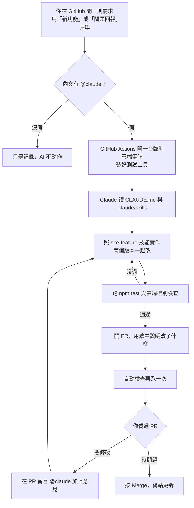

# Agent 工作流：讓 AI 幫你養網站

在 GitHub 寫一則需求，AI 就會在 GitHub 的雲端電腦上照專案規則動手：改程式、跑測試、開 PR。你只要看過、按合併。全程不用開自己的電腦。

## 流程

## 一次性設定（約 10 分鐘）

1. **安裝 Claude GitHub App**：打開 https://github.com/apps/claude ，選擇安裝到這個倉庫。
2. **加入金鑰**：倉庫 → Settings → Secrets and variables → Actions → New repository secret
   - 用 Claude API：名稱 `ANTHROPIC_API_KEY`，值是 Claude Console 的 API 金鑰。
   - 或用 Claude 訂閱（Pro、Max、Team、Enterprise）：名稱 `CLAUDE_CODE_OAUTH_TOKEN`，並把 `.github/workflows/claude.yml` 裡的 `anthropic_api_key` 那一行換成註解寫的那一行。
3. **確認 Actions 已開啟**：倉庫 → Actions，若看到啟用按鈕就按下去。
4. **試一次**：開一則「新功能」需求，例如「範本庫加一個『新品上市』範本」，保留 @claude，送出。幾分鐘後會出現 PR。

## 怎麼下指令最有效

| 想做的事 | 怎麼寫 |
| --- | --- |
| 新功能 | 用「新功能」表單，寫清楚「誰在什麼情況用」「想要的結果」「怎樣算做好」 |
| 修問題 | 用「問題回報」表單，寫重現步驟 |
| 改 PR 裡的細節 | 在 PR 留言：「@claude 按鈕文字改成『放進待剪輯』，手機上字太小也一起修」 |
| 請 AI 審查 | 在 PR 留言：「@claude 用 site-review 技能審查這個 PR」 |
| 出新版 | 開需求：「@claude 用 site-release 技能發佈 1.2.0」 |

一次一件事，比一次塞十件事更快、更準、也更省費用。

## 技能庫（AI 的工作手冊）

AI 每次動手前都會讀 `CLAUDE.md`，再依工作類型使用 `.claude/skills/` 裡的技能：

| 技能 | 內容 |
| --- | --- |
| `site-feature` | 從需求到 PR 的完整流程、改哪幾層、資料模型、實作守則 |
| `site-ui` | 顏色變數、元件、文字語氣、互動規則、完成前檢查表 |
| `site-ai-prompts` | AI 任務三處同步、輸出格式合約、提示詞守則 |
| `site-test` | 自動測試、雲端版檢查、補測試、截圖檢查 |
| `site-review` | 一致性、安全、介面、測試四大類審查清單 |
| `site-release` | 版號、更新紀錄、打包給買家 |

想改變 AI 的做事方式，直接改這些檔案就好。例如想要所有按鈕都更大，就改 `site-ui` 的規則，之後每次 AI 都會照做。

## 安全與費用

- **只有對倉庫有寫入權限的人**留言 @claude 才會觸發，陌生人在公開倉庫留言不會啟動 AI。
- AI 只能改程式、跑 `npm`／`node`／`git` 等指令（`claude.yml` 的 `--allowedTools`），不能碰其他東西。
- AI 一律開 PR，**不會直接改 main**；合不合併由你決定。
- 費用有兩種：GitHub Actions 分鐘數（公開倉庫免費、私人倉庫有每月免費額度），以及 AI 用量（API 計費，或用你的 Claude 訂閱額度）。`claude.yml` 已設單次最多 60 回合、45 分鐘上限。

## 自動檢查（`ci.yml`）

每次推送與每個 PR 都會自動跑：
1. 兩個版本的畫面是否一致
2. 程式語法
3. 瀏覽器全流程測試（24 項）
4. 雲端版型別檢查

PR 頁面看到綠色勾勾才合併；紅色叉叉就在 PR 留言「@claude 自動檢查沒過，請修好」。
