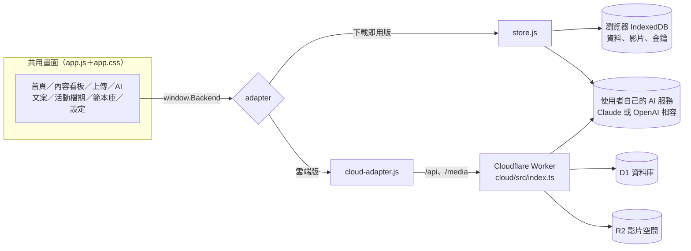
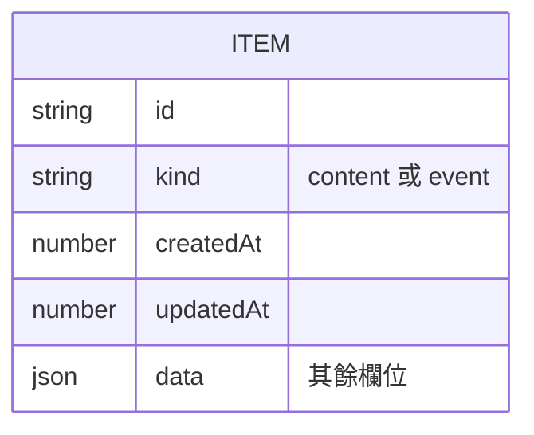

# 架構說明

一句話：**一套畫面，兩種後端**。畫面（`app.js`、`app.css`）只寫一次；資料要存在瀏覽器還是雲端，由換上不同的 adapter 決定。

## 整體架構

## 兩個版本比較

| 項目 | 下載即用版（根目錄） | 雲端版（`cloud/`） |
| --- | --- | --- |
| 怎麼開 | 雙擊 `index.html`，或 GitHub Pages 網址 | 部署到自己的 Cloudflare 帳號 |
| 資料存哪 | 這個瀏覽器（IndexedDB） | 自己的 Cloudflare D1 與 R2 |
| 登入 | 不用 | 密碼登入（PBKDF2、HttpOnly Cookie、錯 5 次鎖 10 分鐘） |
| 多裝置 | 用備份檔搬家 | 自動同步 |
| 影片上限 | 約 1 GB（看瀏覽器空間） | 100 MB／支（Cloudflare 單次請求上限） |
| AI 金鑰 | 存在瀏覽器，瀏覽器直接呼叫 AI | 存在自己的資料庫，伺服器端呼叫 AI |
| 費用 | 0 | Cloudflare 免費方案可開始 |

## Backend adapter 介面

兩個 adapter（`store.js`、`cloud/public/cloud-adapter.js`）提供完全相同的介面，`app.js` 不知道也不需要知道自己跑在哪個版本。

| 成員 | 用途 |
| --- | --- |
| `features` | `login`（要不要登入）、`local`、`uploadMax`、`uploadNote`、`keyNote` |
| `call(path, opt)` | 所有資料操作，路徑見下表 |
| `putMedia(file, onProgress)` | 存影片，回傳 key |
| `mediaUrl(key)` | 取得可播放的網址 |
| `downloadMedia(key, name)` | 下載影片 |
| `exportData()`／`importData(data)` | 備份與匯入 |
| `usage()` | 本機儲存空間用量（雲端版回 null） |

### 資料路徑

| 路徑 | 方法 | 說明 |
| --- | --- | --- |
| `/api/state` | GET | 是否已設定、是否已登入、品牌名與顏色 |
| `/api/setup`、`/api/login`、`/api/logout`、`/api/password` | POST | 登入相關（只有雲端版） |
| `/api/settings` | GET／PUT | 品牌與 AI 設定；金鑰只回傳尾碼 |
| `/api/items` | GET／POST | 列出／新增內容卡與活動 |
| `/api/items/:id` | PATCH／DELETE | 修改／刪除（刪除會一起刪影片檔） |
| `/api/upload` | PUT | 上傳影片（雲端版） |
| `/api/prompt` | POST | 產生完整提示詞（給「複製提示詞」） |
| `/api/ai` | POST | 用使用者的金鑰產生文案或整理活動 |
| `/api/transcribe` | POST | 影片轉 SRT 字幕 |
| `/api/export`、`/api/import` | GET／POST | 備份與匯入 |

## 資料模型

只有一種資料表 `items`，彈性欄位放在 JSON 裡，新增欄位不用改資料表。

- **內容卡**（`kind = content`）：`title`、`cat`、`status`（待剪輯→剪輯中→待審核→已排程→已發布）、`media`、`edited`、`link`、`note`、`plats[]`、`scheduleAt`、`captions`、`srt`
- **活動**（`kind = event`）：`name`、`type`、`date`、`time`、`place`、`contact`、`role`、`status`（詢問中→已確認→已結案）、`steps[6]`、`notes`、`confirm`
- **設定**：`brand`、`intro`、`fields`、`audience`、`tone`、`avoid`、`accent`、`platforms[]`、`aiProvider`、`aiModel`、`aiBaseUrl`、`sttModel`（金鑰另外存）

## AI 提示詞

- `systemPrompt(設定)`：依品牌設定組出語氣與安全規則（不編造事實、缺資料標【待填】、不放價格與個資、繁中）。
- `buildPrompt(設定, 任務, 素材, 平台)`：任務要求＋固定輸出格式 `{"items":[{label,text}]}`。
- 沒有金鑰也能用：`/api/prompt` 回傳同一份完整提示詞，使用者貼到自己的 AI。

## 安全設計

- 所有外來文字經 `esc()` 才放進畫面；外部連結只接受 `https://`。
- 雲端版：寫入請求要帶 `x-app: 1` 標頭（擋跨站請求）；Cookie 為 HttpOnly、Secure、SameSite=Lax；工作階段只存雜湊。
- 金鑰不進程式碼、不進備份檔、不回傳到瀏覽器（雲端版）。
- 資料表在第一次啟動時自動建立，買家不需要跑任何指令。

## 已做的優化

| 優化 | 之前 | 之後 |
| --- | --- | --- |
| 畫面只維護一份 | 兩個版本各一份，改一次要改兩次 | `app.js` 共用＋adapter；`sync-cloud.mjs` 同步、CI 檢查不同步 |
| 刪除 | 按兩次就刪，不說刪什麼 | 確認對話框寫明名稱與後果 |
| 表單錯誤 | 只跳提示 | 顯示在欄位下方，一改就消失，焦點移到出錯欄位 |
| 上傳 | 只有檔案選擇器 | 拖放、檔名大小、影片預覽、進度條 |
| 內容看板 | 只能依狀態篩選 | 加上即時搜尋 |
| 狀態 | 全部同一個顏色 | 待審核強調色、已排程藍、已發布綠、其他中性 |
| 無障礙 | — | 跳到主要內容、換頁焦點移到標題、提示用 aria-live、對話框原生 dialog |
| 觸控 | 部分按鈕 38px | 手機上全部至少 44px |
| 深色模式 | 品牌色文字在深底看不清 | 文字改用自動變亮的 `--hl` |
| 動畫 | 長條圖用高度動畫 | 只用 transform／opacity，尊重「減少動態」設定 |
| 空狀態 | 只有一句話 | 每個空狀態都附下一步按鈕 |
| 測試 | 手動 | `npm test` 24 項瀏覽器全流程，CI 每次推送自動跑 |

## AI 音樂剪輯引擎

影片處理太吃運算，不放在瀏覽器或 Cloudflare，而是在 GitHub Actions 的雲端電腦執行：中控台的影片卡按「交給 AI 音樂剪輯」→ 預填 GitHub 需求表單 → `edit.yml` 工作流跑 `engine/` → 成品放到 Releases 並留言連結。詳見 [MUSIC-ENGINE.md](MUSIC-ENGINE.md)。

## 下一步可以做

1. 瀏覽器內剪輯（ffmpeg.wasm）：剪頭尾、轉直式、壓字卡。
2. 官方 API 自動發布（YouTube Data API、Meta Graph API；TikTok 需審核）。
3. 雲端版多人帳號與角色。
4. 數據回填：各平台觀看數記錄到卡片，首頁顯示成效。
