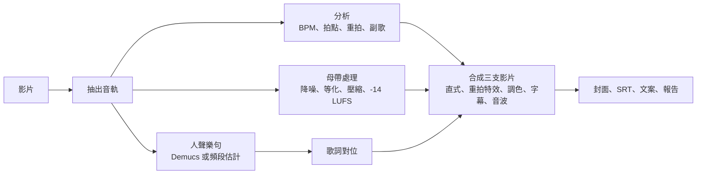

# AI 音樂剪輯引擎

丟一支手機正面拍的演唱或彈唱影片，自動做出三支直式短影音、封面、歌詞字幕檔與宣傳文案。
全部在 GitHub 的雲端電腦上跑，不用開自己的電腦。

## 會做出什麼

| 成品 | 內容 |
| --- | --- |
| 副歌版 | 自動抓最高潮的副歌（預設 30 秒），重拍時畫面跳動，開頭顯示歌名，結尾顯示演出資訊 |
| 歌詞意境版 | 同一段副歌，畫面慢慢推近，大字 MV 歌詞淡入淡出，適合配限動 |
| 預告卡點版 | 副歌裡最大聲的 15 秒，每一拍都跳動，加上音波，演出資訊整支都在 |
| 封面 `cover.jpg` | 副歌版的開場畫面（含歌名） |
| 歌詞字幕 `lyrics.srt` | 對位好的歌詞時間，可匯入 CapCut 或 YouTube 微調 |
| 文案 `copy.md` | IG 貼文、限動短句、短影音說明、LINE 提醒（有 AI 金鑰才自動寫，沒有就附提示詞） |
| 報告 `report.md` | BPM、副歌時間、響度前後對比、發布前檢查 |

所有影片都是 1080×1920、30fps、H.264，可直接上傳 IG Reels、TikTok、YouTube Shorts。
橫拍的影片會自動轉直式：原畫面置中、背景模糊填滿，不會把人裁掉。

## 三種一鍵風格

| 風格 | 畫面 | 重拍特效 | 歌詞 |
| --- | --- | --- | --- |
| 深夜彈唱 | 暖色、柔和暗角 | 重拍輕微放大 | MV 樣式（半透明、淡入淡出） |
| 器材評測 | 清晰銳利 | 每一拍都跳動 | 粗體字卡 |
| Live 燃炸 | 高對比、高飽和 | 重拍放大＋閃光 | 粗體字卡 |

## 怎麼用（GitHub 上）

1. 到倉庫的 **Issues → New issue → AI 音樂剪輯**。
2. 貼影片連結（Google 雲端硬碟或 Dropbox，權限設「知道連結的人都能查看」），填歌名、副歌歌詞、演出資訊，選風格，送出。
3. 幾分鐘後，同一則需求會出現留言，附上所有成品的下載連結（放在倉庫的 Releases）。
4. 要調整就留言：
   - 「重跑」：重做一次
   - 「重跑，從 1:20 開始」：指定副歌位置
   - 「重跑，換成 Live」：換風格（深夜／器材／Live）

在中控台的影片卡打開「發布包」，按「交給 AI 音樂剪輯」會直接帶你到填好歌名與連結的表單。先在「設定 → AI 剪輯引擎」填上 `帳號/倉庫名`。

### 一次性設定
- 想讓文案自動寫好：倉庫 Settings → Secrets → Actions 新增 `ANTHROPIC_API_KEY`（和 @claude 工作流共用）。不設也能剪，只是文案改成附提示詞。
- 只有倉庫擁有者與協作者開的需求會啟動剪輯，陌生人開的需求不會用掉你的運算時數。

## 怎麼用（自己的電腦或任何 Linux）

```bash
sudo apt-get install ffmpeg fonts-noto-cjk
pip install -r engine/requirements.txt
python -m engine promo --video 影片.mp4 --title 夜裡的歌 --lyrics-file 副歌.txt \
  --info "12/20 台北 範例展演空間" --preset live --out 成品
# 選用：--start 80 指定副歌、--length 20 改副歌版長度、--demucs 精準人聲分離
```

## 技術流程



| 步驟 | 做法 | 授權 |
| --- | --- | --- |
| 母帶處理 | FFmpeg：高通 70Hz → 降噪 → 削 250Hz 混濁 → 提 3.2kHz 人聲 → 壓縮 → 限幅 → 兩段式響度標準化 -14 LUFS | LGPL／GPL（系統工具） |
| 節拍與重拍 | Librosa 拍點追蹤；重拍取低頻最強的相位（4/4 拍） | ISC，可商用 |
| 副歌偵測 | 以重拍為起點滑動視窗，分數＝音量 55%＋重複程度（和聲自我相似）25%＋段落起點的能量上升 20% | 自寫 |
| 人聲樂句 | 有 Demucs：分離出的人聲軌能量；沒有：250–4000Hz 能量經中值濾波去掉鼓聲 | Demucs 為 MIT |
| 歌詞對位 | 使用者貼歌詞（唱歌的自動辨識對台語、華語不夠準）；樂句比行數多時用「最小化最長一組」平均分組，少時切開最長樂句 | 自寫 |
| 合成 | FFmpeg：zoompan 重拍縮放、eq 閃光與調色、showwaves 音波、ASS 字幕 | 同上 |

刻意**不用** madmom：程式碼雖是 BSD，但預訓練模型是非商業授權，不能用在要賣的產品。
Remotion 對個人與 3 人以下團隊免費、更大的公司要付費，所以第一版全部用 FFmpeg，之後要更精緻的版型再評估。

## 已驗證

`python -m engine.tests.test_engine` 用合成歌曲（100 BPM、副歌 40–64 秒、10 個人聲樂句）跑完整流程，每次推送都會自動跑：

- 速度偵測 99.4 BPM；重拍落在每小節第一拍
- 副歌開頭誤差在一小節內
- 10 個人聲樂句全部找到，每句長度正確
- 歌詞對位不重疊；行數多於或少於樂句都能處理
- 三支成品都是 1080×1920、長度正確
- 響度處理後落在 -14 LUFS 附近（實測 -14.8）

**還沒在真人影片上驗證**：Demucs 人聲分離只會在 GitHub 上安裝執行；第一位客戶的實拍影片跑完後，請依報告的「發布前請看一下」檢查，並把不準的地方開成需求。

## 下一步（第二、三階段）

1. 講話片段去氣口、去贅字，遇到彈奏與演唱自動保護（Demucs＋Faster-Whisper）
2. 講話自動上字幕（口播大字樣式），唱歌維持 MV 歌詞樣式
3. 雙機位依重拍切換、多張演出照片卡點
4. 插入和弦圖、更多風格預設
